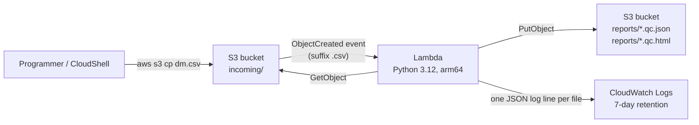

# Serverless SDTM CSV Validator on AWS

Upload a clinical dataset (CSV) to Amazon S3 and, within seconds, get a QC report
back in the same bucket. The checks follow CDISC SDTM conventions for the
**DM** (Demographics), **AE** (Adverse Events) and **VS** (Vital Signs) domains.

It brings together the two halves of my work: clinical data programming
(SDTM rules, controlled terminology, ISO 8601 dates) and cloud engineering
(S3 events, Lambda, IAM, CloudFormation).

> **Scope:** a learning and portfolio project with synthetic data. The checks are a
> practical subset of SDTM conformance rules, not a replacement for Pinnacle 21.

## Architecture



Everything is defined in one CloudFormation template (`template.yaml`):

| Resource | Why it is set up this way |
|---|---|
| S3 bucket | Public access blocked, SSE-S3 encryption, objects expire after 30 days so storage cost stays near zero |
| Lambda function | Standard library only (no layers), arm64 for lower cost, 20 MB file limit |
| IAM role | Least privilege: read only `incoming/*`, write only `reports/*` |
| S3 → Lambda trigger | Fires only for `.csv` files under `incoming/`, so writing reports cannot re-trigger the function |
| Log group | 7-day retention instead of the default "never expire" |

## What gets checked

| Check | Severity | Domains |
|---|---|---|
| Required variables present (e.g. DM: STUDYID, USUBJID, SEX, AGE, AGEU, ARMCD…) | ERROR | DM, AE, VS |
| Expected variables present (e.g. RFSTDTC, AESEV) | WARNING | DM, AE, VS |
| DOMAIN value matches the dataset; a single STUDYID per file | ERROR | all |
| Blank STUDYID / USUBJID | ERROR | all |
| Every `--DTC` variable is ISO 8601 (partial dates such as `2024-03` allowed) | ERROR | all |
| Controlled terminology: SEX, AGEU, AESEV, AESER, AEOUT, VSTESTCD | ERROR (WARNING if only the case is wrong) | DM, AE, VS |
| One record per subject in DM | ERROR | DM |
| `--SEQ` is an integer and unique within USUBJID | ERROR | AE, VS |
| End date before start date (RFENDTC < RFSTDTC, AEENDTC < AESTDTC) | ERROR | DM, AE |
| AGE numeric and non-negative, AGEU present when AGE is; AGE > 120 years | ERROR / WARNING | DM |
| USUBJID ends with SUBJID | WARNING | DM |
| AEOUT = FATAL but AESER = N | ERROR | AE |
| AETERM without a MedDRA preferred term (AEDECOD) | WARNING | AE |
| Vital-sign results outside a plausible range | WARNING | VS |
| Variable names longer than 8 characters (SAS XPT limit) | WARNING | all |

Overall status is **PASS**, **PASS_WITH_WARNINGS** or **FAIL**.

## Project layout

```
src/validator.py         all validation rules (pure Python, unit-testable)
src/lambda_function.py   S3 event handler + HTML report renderer
template.yaml            CloudFormation: bucket, Lambda, IAM role, trigger, logs
scripts/deploy.sh        deploy the stack and upload the code
scripts/run_samples.sh   upload the sample files and print each report's status
scripts/teardown.sh      delete everything
sample_data/             2 clean and 2 deliberately broken SDTM datasets
tests/test_validator.py  unit tests (including a mocked Lambda run)
```

## Deploy (AWS CloudShell, about 2 minutes)

```bash
git clone https://github.com/AnasSameed/Clinical-Research.git
cd Clinical-Research/aws-sdtm-validator
bash scripts/deploy.sh        # creates the stack and uploads the code
bash scripts/run_samples.sh   # uploads sample_data/*.csv and shows the results
```

Validate your own file:

```bash
aws s3 cp my_dm.csv s3://<BucketName>/incoming/my_dm.csv
aws s3 cp s3://<BucketName>/reports/my_dm.qc.json -
```

Remove everything when you are done:

```bash
bash scripts/teardown.sh
```

## Results on the sample data

| File | Status | Records | Errors | Warnings |
|---|---|---|---|---|
| dm_clean.csv | PASS | 8 | 0 | 0 |
| vs_clean.csv | PASS | 8 | 0 | 0 |
| dm_with_errors.csv | FAIL | 7 | 9 | 3 |
| ae_with_errors.csv | FAIL | 7 | 7 | 1 |

Example findings from `ae_with_errors.csv`:

```
ERROR   DUPLICATE_SEQ       row 3  AESEQ 2 is repeated for USUBJID 'CDISCPILOT01-701-1015'.
ERROR   END_BEFORE_START    row 4  AEENDTC (2024-08-01) is before AESTDTC (2024-08-07).
ERROR   FATAL_NOT_SERIOUS   row 6  AEOUT is FATAL but AESER is N; a fatal event is always serious.
ERROR   CODELIST_VIOLATION  row 6  AESEV 'LIFE THREATENING' is not in the controlled terminology.
ERROR   INVALID_ISO8601     row 7  AESTDTC '2024-03-20T25:00' is not an ISO 8601 date/time.
WARNING AEDECOD_MISSING     row 5  AETERM 'ATRIOVENTRICULAR BLOCK' has no MedDRA preferred term.
```

## Run the tests locally

```bash
pip install pytest boto3
python -m pytest -q
```

## Cost

With the AWS Free Tier this costs nothing for normal practice use: Lambda includes
1 million requests a month, and each validation runs for well under a second.
The 30-day object expiry and 7-day log retention stop storage from piling up.
`scripts/teardown.sh` removes every resource.

## Ideas for next steps

- Cross-domain checks (every AE.USUBJID must exist in DM)
- Read SAS XPT files as well as CSV
- Email a summary with Amazon SNS when a file fails
- Load the full CDISC controlled terminology instead of the built-in subset
